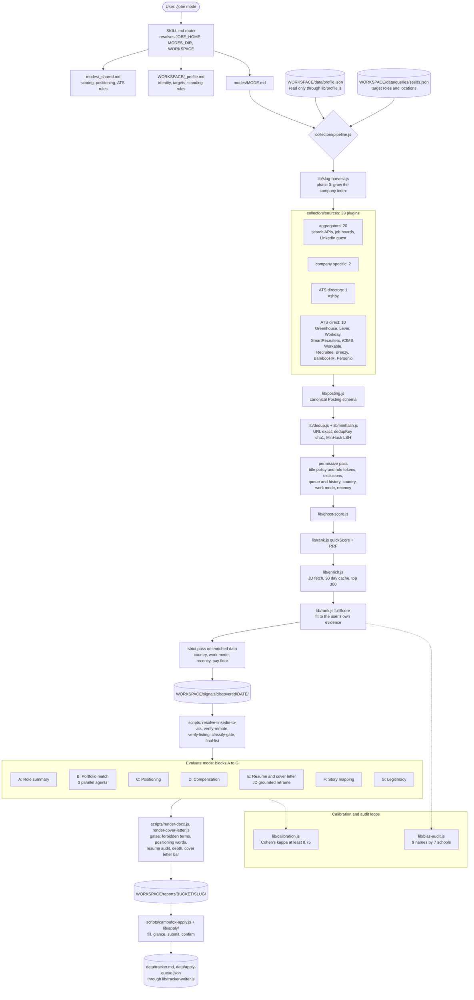

# Jobe: Architecture

## Component diagram



## Layers

Two layers, split in `lib/config.js`. The file by file list is in [`DATA_CONTRACT.md`](DATA_CONTRACT.md).

* **System layer** at `getSystemRoot()`: code, modes, `configs/`, `templates/`, the shared tenant seed `configs/portals.json` (ships empty), and the shared staffing list. The same for every person on the machine.
* **User layer** at `getUserRoot()`: one workspace per person under `users/<slug>/`, or the install root in single user mode. Resolution order: env `JOBE_USER_ROOT` (absolute path), env `JOBE_USER`, the `users/.active` pointer, the install root.

There are three copies of that resolution and they must stay in step: `lib/config.js` (the authority), the router's Step 0 in `SKILL.md` (it shells out to `node scripts/user.js current --path`, which prints `getUserRoot()`), and `web/src/lib/paths.ts` for the dashboard.

Nothing in code encodes a profession, a country, a work arrangement, or a seniority preference. Three user files carry all of it:

| File | Carries | Read through |
|---|---|---|
| `data/queries/seeds.json` | target roles and locations | `lib/role-queries.js` (`roleStrings`, `makeTitleMatcher`), `lib/rank.js buildProfile` |
| `data/bullet-library.json`, `data/resume-baseline.json` | skills and evidence | `lib/rank.js buildProfile`, `lib/bullet-select.js`, `lib/tailor.js` |
| `data/profile.json` | policy: work modes, countries, recency, title rules, pay floor, candidate facts, output rules | `lib/profile.js` only |

When a file is missing the behavior is permissive: nothing is filtered, scoring is neutral, a source that needs search terms returns nothing and says so.

## Execution model

1. **Router** (`.claude/skills/jobe/SKILL.md`). Resolves the code root, the modes folder, and the active workspace, loads `modes/_shared.md` and the workspace `_profile.md`, then the mode file for the first word of the command.
2. **Policy** (`lib/profile.js`). `loadProfile()` reads `data/profile.json` over permissive defaults and never throws. `discoveryFilters(profile)` gives the pipeline its filter object, and `titlePolicy(profile)` compiles the title rules. The same module holds the gates every stage shares: `countryOk`, `regionOk`, `modePass`, `recencyDays`, and `pageSetup` for the renderers. Every call site merges as `{ ...discoveryFilters(loadProfile()), ...flags }`, so a command line flag wins over the file and the file wins over the default.
3. **Slug harvest** (`lib/slug-harvest.js`, needs a Brave key). Before the sources run, twelve `site:` patterns across eleven ATS hosts are searched with up to three seed roles each. New tenants land in `data/companies/index.json` and the per company crawlers read them in the same run.
4. **Sources** (`collectors/sources/**`). All 33 plugins run in parallel, each behind its own rate limiter. A plugin with a missing key, an unset opt in flag, no seed roles, or no tenants returns `[]`. Search terms come from `roleStrings(ctx)` and title gates from `makeTitleMatcher(ctx)`; no plugin holds role vocabulary or an employer list. See [`docs/discovery-sources.md`](docs/discovery-sources.md).
5. **Three pass dedup** (`lib/dedup.js`):
   * Pass 1: canonical URL equality (merges `alternateUrls`).
   * Pass 2: exact `dedupKey` = `sha1(company slug, normalized role)`. Location is left out of the key, so under a remote only policy one requisition listed in several places collapses. Under any other policy the city is part of the merge (and of the applied or skipped history match), so the same title in two cities stays two rows. Every remote, country only, or empty location of one employer and title is one row per country; a hybrid location with no city is a row of its own; real cities stay apart. A remote row the US classifier does not place in the US keeps its own place token as the key, so it never merges into the US remote row and still reaches the country gate (cost: two wordings of one such place stay two rows). The report slug follows the same rule (`lib/dedup.js reportSlug`: `{company}-{role}`, plus the city unless the policy is remote only), so two cities never share a report folder, queue row, or tracker row. Known ceiling: a posting whose title or company is written in a non Latin script is discarded at `createPosting` (posting text is ASCII only so dedup keys stay stable), and a non Latin location is read as no location.
   * Pass 3: MinHash LSH over bigram shingles of company, title, and primary location, at Jaccard 0.70 or higher.
6. **Permissive pass** (`applyFilters`). Title policy and role tokens (`rank.isRoleMatch`), excluded companies (`lib/exclusions.js`: your negative list plus the staffing list), queue addresses, applied and skipped history by `dedupKey`, country, work mode, region, recency. Before enrichment a posting is dropped by country, work mode, or region only when it is already known to be outside your policy. For a country list other than exactly `["US"]` that means its location names a country outside the list (a city alone is unknown and kept). The region rule (`discovery.regions`) reads only hybrid and onsite postings.
7. **Ghost score** (`lib/ghost-score.js`). Five signals, max pooled. The age signal measures against the larger of 30 days and your recency window, and is off when the window is 0. Postings labeled Suspicious are hidden unless `--show-ghosts`.
8. **Quick rank, enrich, full rank.** `quickScore` only sets enrichment priority. `lib/enrich.js` fetches the job description, compensation, location, and original publish date for the top 300, eight at a time, with a 30 day cache. `fullScore` then scores every posting that has job description text.
9. **Strict pass** (`finalizeRemoteAndRecency`). On enriched data: country, work mode (a posting that still states none counts as onsite), region, recency, and the pay floor. A posting is dropped for pay only when a published yearly band in your `discovery.salaryCurrency` tops out below `discovery.salaryFloor`; unknown pay (no band, another or an unstated currency, a non yearly period) is kept and labeled `salaryCheck: "unknown"`.
10. **Persist.** Every stage is written under `signals/discovered/{date}/` so any step can be inspected afterwards. `discovery-summary.json` carries `needsAgentFallback`, which the find mode uses to launch the `jobe-job-discovery` agent; `lib/agent-import.js` merges what the agent finds through the same filters.
11. **Verification** (scripts, run by the find mode). `resolve-linkedin-to-ats.js` and `verify-remote.js` turn LinkedIn leads into employer listings with a confirmed work mode. `verify-listing.js`, `classify-gate.js`, and `final-list.js` are optional helpers before resume generation; `final-list.js` applies the same strict work mode, country, region, and title rules to the verified data.
12. **Evaluation** (blocks A to G) runs per posting. Block B spawns three parallel agents defined in `.claude/agents/jobe-*.md`. Block E is the tailoring step described below.
13. **Rendering and apply.** Described below.

## The score

`lib/rank.js fullScore(posting, { profile })`. The score measures one thing: how well the role's stated requirements map to your actual evidence. Preferences never enter it; they belong in filters.

Skill proficiency is derived from your own files:

| Source of the skill | Level |
|---|---|
| A keyword on a bullet in `data/bullet-library.json` | 1.0 |
| Listed only in the resume skills block, or found in the optional evidence index | 0.6 |
| Declared in `skills.gaps` | 0.2 |
| `skills.levels` in the profile | overrides any of the above |

A skill at 0.6 or above is held. A differentiator is a skill you rated 0.9 or above yourself in `skills.levels`; a library keyword counts 1.0 for coverage but is not a differentiator on its own.

```
rated     = the skills you rated in skills.levels that the JD names
derived   = share of the JD's content words found in your evidence
            (bullet text and keywords up to 1.0, skills block or evidence
            index 0.6, declared gap 0.2), stretched so 16 percent of the words
            is none and 82 percent is full; a description under 60 content
            words is pulled toward 0.5 in proportion. Pay, benefits, equal
            opportunity, how to apply and working condition text, employer
            voice sentences with no ask, and closing side sections are not
            counted. In a library of hundreds of bullets a word is full
            evidence only when several bullets carry it.
ratedness = min(1, rated terms / 40) * min(1, share of rated weaknesses / 0.2)
            (how far your table stands alone; a rated term is a weakness in
            full at 0.5 or below, in proportion between 0.5 and 0.6)
trust     = min(1, mean over rated terms of max(0, 0.9 - level) / 0.12)
            (how far a rated skill the JD names counts as rated; a table of
            strengths alone, every level 0.9 or above, has trust 0; its
            terms still count as evidence in the derived estimate at the
            level you gave, so a posting that names rated skills your
            bullets do not carry scores a point or two higher for each one
            and can cross the 55 floor)
field     = on a posting whose title names no target role word, ratedness
            and trust are both multiplied by
            min(1, max(derived / 0.5, named * min(1, derived / 0.25)))
            with named = min(1, (rated skills the JD names - 1) / 2)
            (three rated skills named halve the coverage the posting needs
            and never open the table by themselves; a rated term is also
            evidence, so the table should hold only skills specific to
            your field)
prior     = (1 - ratedness) * derived + ratedness * 0.5
weight    = 8 * (1 - ratedness)
coverage  = (trust * sum of the levels of the rated skills the JD names + weight * prior)
            / (trust * number of those skills + weight)
            (derived alone with nothing rated or with trust 0, the rated mean
            alone with a full table that also rates weaknesses; 0.5 with
            nothing on file or when both terms are zero)

d     = min(8, 1.2 * n ** 0.75) for n differentiators the JD names
role  = min(8, 3 per target role word in the title * (1 - ratedness))
score = 34 + coverage * 44                    (34 to 78 from fit alone; neutral 56)
      + trust * d + (1 - trust) * min(d, role)                    (differentiators)
      + trust * min(8 - d, role) + (1 - trust) * (role - min(d, role))  (role words)
      + 3   when the title carries a seniority word your own seed titles carry
      - 15  PhD required and your known degree is below a doctorate
      - 18  clearance required and candidate.clearance says you hold none
      - 5   a 10 to 15 plus years ask above candidate.yearsExperience
      clamp to 0..100
      - 6   per stated minimum you do not meet (years, advanced degree, a declared gap named as required)
```

Every candidate fact check is skipped when the fact is unknown. With no skills on file the fit part is the neutral 56 and only the title bonuses move it (at most 67). Until `skills.levels` is filled in the score tracks field and breadth, not your own ranking of your skills; onboarding asks you to rate 20 to 40 of them, the weak ones included (a table of only top marks carries no information: with every level at 0.9 or above trust is 0 and the table is not counted as a rating; its terms still count as evidence, so a posting that names them scores higher and can cross the 55 floor), and the find mode asks before generating resumes while the table is empty. Differentiator and role word points never exceed 8 together; for the untrusted share of the table the differentiator points take the place of role word points instead of adding to them. Skill terms in `rankReason` are shown in matching form (lowercase, accents folded). Outputs: `matchScore`, `fitCoverage`, `minimumsUnmet[]`, `rankReason`, and `gatePass`:

* `gate1`: `score >= 55`, the JD left enough to judge, and `coverage >= 0.5 * ratedness` (ratedness after the field check; with nothing rated, the score floor alone)
* `gate2`: the largest years ask is at most `candidate.yearsExperience` (unknown years passes)
* `minimums`: no stated minimum unmet

`quickScore` is not a fit claim. It is 1, plus 1 for a seniority word your own seed titles carry, plus 0.6 for a posting at most 7 days old or 0.3 at most 14, plus 0.4 for a direct ATS address.

`fuseRanking` is Reciprocal Rank Fusion with k of 60 over up to three rankings: held skill overlap (proficiency weighted), freshness, and a seniority level your seeds name. A signal your files cannot express is left out instead of being fused as a flat ranking. The final order is `matchScore`, then `rrfScore`.

The title gate `isRoleMatch(title, profile)` is a discovery filter only. It applies your title policy first (a title is dropped when an exclude phrase matches outside every keep phrase; a keep phrase shields only its own words), then checks the title against your role tokens with inflection tolerant matching (`lib/role-queries.js tokensMatch`: equal, or a common prefix of at least 4 characters and 70 percent of the shorter token). With no seeds it keeps every title.

## Resume tailoring and render gates

The bullet library is a candidate pool, not the resume.

1. `lib/tailor.js analyzeJD` extracts keywords, responsibilities, and qualifications from the job description. Keywords are counted over the responsibilities and qualifications sections only (the whole text unless both sections are found; English function words are excluded, and the scoped text ends where a bulleted section returns to prose), and the hiring company's name is left out when the caller passes it (`analyzeJD(jd, { exclude: [company] })`; `auditResume` reads it from the resume JSON's top level `company`, and `scripts/tailor-brief.js` passes it when its input is a `posting.json` or `--url` record). `seniority` is the level word in the JD's first line (principal, staff, senior, lead) or null, never a guess from body text. `rankEvidence` ranks your library against them. `tailorBrief` adds `coverage.gaps`: top terms with no evidence, after crediting your skills block and the optional evidence index. `scripts/tailor-brief.js` prints the brief.
2. `lib/bullet-select.js buildExperience` and `pickProjects` select and order bullets per role key. Requirement terms weigh above generic keyword overlap; an archetype match is a bonus, never a gate; one bullet is kept per `studyGroup`. `companyKeyMap` keeps each employer's bullets under that employer.
3. The model then reframes (evaluate mode, Block E): reorder each entry to lead with the evidence this role asks for, restate real evidence in the job description's vocabulary without inventing, write a role specific summary, pick the matching projects, and name the honest gaps.
4. `lib/tailor.js auditResume(resume, jdText, opts)` checks the result: required sections; every baseline degree still present; the baseline's first employer leads and entries are reverse chronological; summary 35 to 80 words; at most 4 projects of at most 65 words; no duplicate skills; metric density between 0.8 and 2.5 per bullet; uniform openers and other machine writing tells; bullet length; a specific `whyCompany` (it must carry a number, a double quoted phrase, or a proper noun other than the employer's own name: a named program, unit, service, regulation, product, publication, or award); and, with the job description, vocabulary coverage, requirement to bullet mapping, center of gravity, and skills with no backing bullet. With `opts.pageMetrics` it gates on the rendered page against `output.targetPages`; with no target, page fill is never an issue.
5. `auditProse(text)` is an advisory linter for prose fields. It never gives an authorship verdict.

`scripts/render-docx.js` and `scripts/render-cover-letter.js` run these gates before anything is written:

| Gate | Default | Under `--strict` or `JOBE_STRICT_AUDIT=1` |
|---|---|---|
| A term from `output.forbiddenTerms` | fatal | fatal |
| Positioning vocabulary (the modes' internal framework words) | fatal | fatal |
| Resume audit (JD aware when `jd.txt` sits beside the JSON) | warns | blocks |
| Method depth (`data/evidence-depth.json`) | warns | blocks |
| Cover letter bar: a measurable outcome, a leadership or scope signal, a decision the work drove | warns | blocks |

The resume renders Summary, Selected Projects, Experience, Skills, Education, Awards, with native Word list bullets, lines kept together, blank author metadata, and an optional `layout: "compact"`. `lib/normalize.js`: every dash and bullet glyph, smart quotes, and ATS illegal characters are always folded to safe ASCII, and invisible characters and emoji are removed; letters, marks, digits, punctuation and currency signs of every script are kept as written (plus the degree, plus minus, times, divide and numero signs). Plain hyphens are removed only when `output.stripHyphens` is true, and `output.asciiOnly: true` folds accented Latin letters to their base letter, writes out symbols that carry meaning (the micro sign as "u", degree, plus or minus, currency signs) and removes every other script. Paper size (`output.pageSize`: Letter or A4) and the cover letter date format (`output.dateLocale`) come from `lib/profile.js pageSetup`; unset, the page is Letter when your country list is empty or names a country that uses Letter paper (the US, Canada, Mexico, the Philippines and several countries in Latin America), A4 otherwise, and dates are en-US. The cover letter renderer uses the greeting and sign off the letter itself carries; it adds "Dear {company} Hiring Team," and "Sincerely," only to an English letter that has none. The contact line prints phone, email, location, LinkedIn, `contact.website`, and `contact.github`. `scripts/check-docx-pages.js` measures pages and last page fill through headless LibreOffice. `scripts/docx-to-pdf.js` converts the reviewed DOCX to a PDF with selectable text (needs LibreOffice and `pdftotext`).

Six `scripts/wf-*.js` files run batches of this work under the Claude Code Workflow tool (generate, recenter, fill, compress, evidence extract, bullets from evidence). They are not Node modules. On a host without that tool the batch mode's sequential path does the same work.

## Report lifecycle

A report folder lives at `reports/{bucket}/{slug}/` with buckets `verify`, `evaluate`, `queue`, `manual`, `applied`, `skipped`, `archive`, `audit`. `lib/tracker-writer.js` exports the list (`LIFECYCLE_BUCKETS`), the one locator (`locateReportDir`), and the one mover (`moveReportFolder`), and writes `data/tracker.md` and `data/apply-queue.json` atomically. The apply harness, the queue prune, and the dashboard all call the locator, so there is a single bucket list.

## Apply harness

`scripts/camoufox-apply.js` drives one application in a stealth Firefox (Camoufox), headless by default. One long lived process per job keeps the form alive across the review and the confirmation. The agent and the harness talk through two files, `signals/apply/{slug}/state.json` and `control.json`.

* `lib/apply/url-normalize.js` rewrites a posting address to the address that shows the form (Greenhouse board and careers wrapper pages to the embed form, Ashby to `/application`). Workday is marked for a person. The wrapper map ships empty (`configs/apply-wrappers.json`, workspace override `data/apply-wrappers.json`).
* `lib/apply/answers.js` builds the answers from the report's resume JSON and your `data/apply-profile.json`. A blank eligibility answer is never guessed; the question is surfaced at the glance. Salary comes from the band the live posting publishes through your `salaryStrategy`, unless `--salary` is passed.
* `lib/apply/filler.js` scans and fills Greenhouse, Lever, and Ashby forms by label. Free text questions are returned for the agent to answer from real evidence, never invented. EEO questions decline unless you opted in, and then match your own wording by whole phrase.
* The location guard follows `discovery.workModes` and `discovery.countries`. With no policy it blocks nothing. `--allow-onsite` skips it for one run.
* Ashby boards use a warm mode: a persistent profile under `signals/apply/_profiles/`, human paced typing, and one run at a time.

## Manual ingest side channel (LinkedIn)

The automated pipeline reaches only public, signed out inventory. Two opt in, user present modes reach the personalized inventory through the Chrome extension:

* `linkedin-tab` reads a LinkedIn Jobs tab you already have open (read only).
* `linkedin-search` drives your own signed in search across your seed roles and paginates at a human pace.

Both feed `collectors/ingest-manual.js`, which parses the extension's accessibility dump (`lib/linkedin.parseSearchCards`), drops excluded companies (`lib/exclusions.js`), then normalizes, dedups, and role matches into the same `signals/discovered/{date}/` folder. `lib/linkedin.buildSearchUrl` takes its work mode facet, geo, and recency preset from your profile; with no policy there is no facet and no geo restriction. The browser drive is agent orchestrated because a Node source plugin cannot call the extension. Account safety is a hard rule: never unattended, headless, or scheduled, and never solve a CAPTCHA.

## Evidence layer (optional)

`scripts/evidence-index.js` scans the folders in `evidence.roots` for your own vocabulary and writes `data/evidence-index.json`. `tailorBrief` and `buildProfile` credit it, so a tool present in your own work never reads as a gap. It helps only when your evidence is plain text on disk, and it is a no op with no roots. `scripts/check-evidence-coverage.js` and `scripts/check-evidence-depth.js` are optional gates over the bullet library. See [`docs/evidence-retrieval-layer.md`](docs/evidence-retrieval-layer.md).

## Why these specific algorithms

### MinHash LSH for dedup (not string similarity)
Pairwise string similarity does not scale or compose. MinHash gives a sub linear index (LSH bands) that makes "find all near duplicates above Jaccard 0.70" cheap on thousands of postings.

Parameters (128 permutations, 18 by 7 bands, 126 hashes used) follow the datasketch library's production defaults. Bigram shingles, not trigrams, because posting text is short and a single word edit would otherwise collapse the similarity.

Reference: [LSHBloom arXiv 2411.04257 (2024)](https://arxiv.org/abs/2411.04257).

### RRF for ordering (not learned ranking)
The signals are on different scales with different noise. Linear weighting needs coefficients that must be tuned again whenever a signal is added. RRF fuses ranks, not scores, and has one parameter, k.

k of 60 beat dense only retrieval by 1.4 percent nDCG@10 and BM25 only by 18 percent on BEIR and MS MARCO in Bruch et al.

Reference: [Bruch et al, ACM TOIS 2024](https://dl.acm.org/doi/10.1145/3654207).

### Max pool for the ghost score (not sum)
If any one signal strongly suggests a ghost posting, the posting should be flagged even when the others look clean. A sum would wash a strong signal out. Labels: below 0.30 High Confidence, 0.30 to 0.60 Proceed with Caution, 0.60 and above Suspicious.

References: [Clarify Capital 2024 (n=1,200)](https://www.clarifycapital.com/job-listings-survey); [Hunter Ng arXiv 2410.21771](https://arxiv.org/abs/2410.21771).

### Cohen's kappa for judge calibration (not raw agreement)
Two judges who both label 95 percent of items "high quality" show 95 percent raw agreement even when guessing independently. Kappa corrects for chance. The 0.75 threshold comes from [arXiv 2506.13639 (2025)](https://arxiv.org/abs/2506.13639).

### Name and school perturbations for the bias audit
Bertrand and Mullainathan (2004) method: hold the resume constant, change only the name and the school, measure score variance. 9 names and 7 schools (Ivy, state, HBCU, international top, international other, community college, and the original). The 15 percent variance threshold is a pragmatic choice informed by [Brookings 2024](https://www.brookings.edu/articles/rethinking-the-impact-of-ai-on-hiring/).

## Data flow for a single run

```
/jobe find
  load modes/_shared.md, WORKSPACE/_profile.md, modes/find.md
  scripts/prune-queue.js                 drop dead queue rows, keep all history
  collectors/pipeline.js
      filters = flags over data/profile.json over permissive defaults
      slug harvest                       grow data/companies/index.json
      33 sources in parallel             rate limited, each returns Posting[]
      dedup                              URL, dedupKey, MinHash LSH
      permissive pass                    role, exclusions, queue, history, country, work mode, recency
      ghost score, quickScore, RRF
      enrich top 300                     JD, pay, location, original date; 30 day cache
      fullScore                          fit to your own evidence
      strict pass                        country, work mode, recency, pay floor
      write signals/discovered/DATE/
  agent fallback when recall is low      lib/agent-import.js merges it
  resolve-linkedin-to-ats.js, verify-remote.js
  for each top posting
      evaluate blocks A to G
      render resume and cover letter     reports/queue/SLUG/
      queue entry and tracker row        lib/tracker-writer.js
/jobe apply-all
  scripts/camoufox-apply.js per job      fill, glance, submit, confirm
  moveReportFolder(slug, 'applied')
```

## Tests

`npm test` runs `node --test test/*.test.js` on Node's built in runner, with no extra dependency and no network. Each test points `JOBE_USER_ROOT` at a fresh temporary folder before it loads any `lib/` module, so the suite never reads or writes a real workspace. Fixtures are synthetic and come from unrelated professions. `test/docs-facts.test.js` fails when these documents drift from the code (source count and ids, lifecycle buckets, profile keys, file paths named in the docs).

## Extension points

* **Add a discovery source.** Drop a file under `collectors/sources/<category>/` exporting `{ id, name, requires, rateLimit, discover(ctx) }`. Take search terms from `roleStrings(ctx)` and the title gate from `makeTitleMatcher(ctx)`, honor `ctx.filters`, return canonical postings. Read `collectors/sources/_interface.md` first. Helpers go in `lib/`, because every `.js` file in a source folder is loaded as a plugin.
* **Add a policy key.** Add it to `DEFAULTS` in `lib/profile.js` and to `templates/profile.template.json`, read it through `loadProfile()`, and document it in `DATA_CONTRACT.md`.
* **Add a user file.** Template in `templates/`, a scaffold line in `scripts/user.js`, a writing step in `modes/onboard.md`, a line in `.gitignore`, a row in `DATA_CONTRACT.md`. Place it under `data/` so `migrate` carries it.
* **Define archetypes.** Write `data/archetypes.json` in your workspace (`templates/archetypes.template.json` shows the shape) and tag bullets with the same names. No code change.
* **Add a mode.** Add `.claude/skills/jobe/modes/<mode>.md` and a row in the router table in `SKILL.md`.
* **Swap the judge.** `lib/calibration.js` treats the judge as a black box. Any callable that returns a label and a rationale works.
