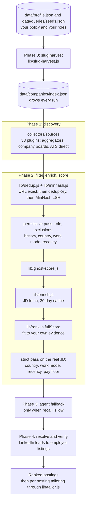

# Jobe

**A career intelligence skill for [Claude Code](https://claude.com/claude-code), for any profession.** Jobe searches the open job market for the roles you name, ranks postings against your own evidence, and writes ATS clean resumes and cover letters whose every claim traces to something you can back up. It runs as slash commands inside Claude Code: `/jobe onboard`, `/jobe find`, `/jobe <url>`, `/jobe apply-all`, `/jobe tracker`.

[](LICENSE)
[](https://claude.com/claude-code)
[](https://nodejs.org/)

```bash
/jobe onboard              # guided setup: your roles, your evidence, your preferences
/jobe find                 # discover, dedup, rank, verify; evaluate the top matches
/jobe <posting-url>        # one posting: analysis, tailored resume, cover letter
/jobe batch url1 url2 ...  # several postings, each resume tailored to its own posting
/jobe apply-all            # fill and submit the queue, with a review before every submit
/jobe tracker              # discovered, evaluated, applied, responded, offer
```

Jobe assumes nothing about your field. A registered nurse who onboards gets nursing searches, a nursing title gate, and scoring against nursing evidence. A tax accountant gets the same machinery pointed at accounting. There is no role list, skills table, or employer list in the code: all of it comes from the files onboarding writes for you.

## Table of contents

1. [Quick start](#quick-start)
2. [What Jobe does](#what-jobe-does)
3. [How it works](#how-it-works)
4. [All commands](#all-commands)
5. [Multiple users on one machine](#multiple-users-on-one-machine)
6. [Configuration](#configuration)
7. [Scripts](#scripts)
8. [Why Jobe (defensibility)](#why-jobe-defensibility)
9. [Empirical backing](#empirical-backing)
10. [FAQ](#faq)
11. [Privacy and the data contract](#privacy-and-the-data-contract)
12. [Contributing](#contributing)
13. [License](#license)

---

## Quick start

You need [Claude Code](https://claude.com/claude-code), [Node.js](https://nodejs.org/) 22 or newer, and Git.

```bash
git clone https://github.com/montebelle/jobe-skill.git
cd jobe-skill
npm install
```

Open Claude Code in that folder, then:

```
/jobe onboard
/jobe find
```

That is the whole setup. The skill lives in the repo's `.claude/` folder, so Claude Code picks it up when you start it inside the clone.

### What onboarding does

`/jobe onboard` is a guided interview (15 to 30 minutes; paste your current resume up front and it goes faster). You answer in plain language and Jobe writes every personal file:

| It asks about | It writes |
|---|---|
| Who you are, the roles you want, where, your work eligibility | `_profile.md`, `data/queries/seeds.json` |
| Your work history | `data/resume-baseline.json` |
| What you did and how you can prove it, project by project | `reference.md`, `data/bullet-library.json` |
| What a search should keep: remote, hybrid, onsite; countries; regions for hybrid and onsite work; how recent; titles to drop; a salary floor and its currency; page size and date format | `data/profile.json` |
| Employers you never want to see, and employers you want watched | `data/companies/negative-list.json`, `data/companies/portals.json`, `data/companies/non-tech-seed.json` |
| Answers application forms ask for that a resume does not carry | `data/apply-profile.json` |
| API keys (all optional) | `.env` |

Every preference is optional. Leave one out and nothing is filtered on it. Two short examples of what ends up in `data/profile.json`:

```json
{ "candidate": { "yearsExperience": 6, "degrees": ["BSN"] },
  "discovery": { "workModes": ["onsite", "hybrid"], "countries": ["US"], "titleExclude": ["travel"], "salaryFloor": 80000 } }
```

```json
{ "candidate": { "yearsExperience": 9, "degrees": ["BS Accounting", "MS Taxation"] },
  "discovery": { "workModes": ["remote"], "countries": ["CA", "Canada"], "maxAgeDays": 21, "titleExclude": ["intern"] } }
```

The first is a registered nurse who wants onsite or hybrid roles in the United States and no travel contracts. The second is a tax accountant who wants remote roles in Canada posted in the last three weeks.

You can run a single section again later: `/jobe onboard profile`, `/jobe onboard resume`, `/jobe onboard evidence`, or `/jobe onboard keys`.

### First real run

```
/jobe find
```

The pipeline logs each stage:

```
[info] pipeline sources loaded: adzuna, arbeitnow, brave-search, ...
[info] pipeline slug-harvest: +<n> new slugs across <n> queries (index: <n>)
[info] pipeline total raw: <n>
[info] pipeline after dedup: <n>
[info] pipeline after filter: <n> (rejected: role=<n> recency=<n> loc=<n> work-mode=<n> queue=<n> applied/skipped=<n> excluded-company=<n>)
[info] pipeline enriching top <n> (concurrency 8)
[info] pipeline post-enrich gate: kept <n> (dropped work-mode=<n> stale=<n> country=<n> below-pay-floor=<n>)
[info] pipeline done. wrote <workspace>/signals/discovered/<date>
```

Jobe then evaluates the matches that score 80 or above, lists the 65 to 79 band for your confirmation, and lists the rest. Output for each evaluated posting goes to `reports/queue/{slug}/`: a tailored resume DOCX, a cover letter DOCX, and an analysis. Each one is added to `data/apply-queue.json` for the next `/jobe apply-all`.

To see what a run would do without touching the network:

```bash
node collectors/pipeline.js --dry-run     # prints the sources, your seed roles, and your merged filters
```

### Optional extras

| For | Install |
|---|---|
| Much wider discovery | A free [Brave Search API key](https://api.search.brave.com) (2,000 queries a month, no card). Onboarding offers to save it. |
| Auto apply | `npx camoufox-js fetch` (a one time browser download of roughly 300 MB) |
| The page length gate and PDF output | LibreOffice (`soffice`) and poppler (`pdfinfo`, `pdftotext`) on your PATH |
| The LinkedIn modes | The Claude in Chrome extension |
| `/jobe` from any folder | `./install-local.sh` copies the skill to `~/.claude/skills/jobe/` and the code to `~/.jobe/` |

---

## What Jobe does

Jobe runs four loops over your job search.

* **Discover.** `/jobe find` runs 33 source plugins in parallel (search APIs, job boards, employer ATS boards). Your seed roles are the queries. Results are deduplicated with MinHash LSH, filtered by YOUR policy (work mode, country, recency, title rules, salary floor, excluded companies), scored for ghost job risk, enriched with the full job description, and scored for fit against your own evidence. Leads the pipeline cannot confirm, such as LinkedIn guest results, are resolved to the employer's own listing and verified before they are shown.
* **Evaluate.** For each posting that passes the gates, Jobe analyzes the role in seven blocks (A to G) and writes a resume and cover letter grounded in that job description. Your bullet library is the candidate pool; the resume is reframed from it in the posting's own vocabulary, with real figures preserved and nothing invented. Audits check the result before it renders.
* **Apply.** `/jobe apply` fills real application forms on Greenhouse, Lever, and Ashby in a stealth browser (Camoufox), shows you a screenshot and a field summary, and submits only after that review. It answers eligibility questions only from your own apply profile and asks you when an answer is not on file. Demographic questions are declined unless you opt in. `--paste` gives paste ready blocks for forms behind a sign in wall.
* **Track.** A markdown tracker and an apply queue, with conversion rates, follow up cadence, and a report folder per job that moves through lifecycle buckets as its status changes.

Jobe is not a spray and pray auto applier and not a generic resume rewriter. Every claim it puts on a resume traces to an entry in your evidence file. Every score traces to a documented method.

### Optional: a local dashboard (`web/`)

A Next.js dashboard in `web/` shows the pipeline on your own machine: overview funnel, queue management with keyboard shortcuts, per posting pages with resume and cover letter previews, analytics, and the latest discovery run. It reads your local files; nothing leaves the machine. Report pages and the apply and skip buttons work for a folder in any lifecycle bucket.

```bash
npm run web:install   # one time
npm run dev           # http://localhost:3000
```

The dashboard resolves the active workspace once at server start, so after `/jobe use <name>` restart it (or start it as `JOBE_USER=<name> npm run dev`). See [`web/README.md`](web/README.md).

The dashboard runs from the clone and shows the clone's workspace; `web/` is not part of a global install. If you used `./install-local.sh` and your files live under `~/.jobe`, start it from the clone as `JOBE_USER_ROOT="$HOME/.jobe" npm run dev` (for a named workspace: `JOBE_USER_ROOT="$HOME/.jobe/users/<name>" npm run dev`). The value must be an absolute path.

---

## How it works



Each phase is deterministic and can be inspected by itself: every stage is written under `signals/discovered/{date}/`. The model reasons inside stages; it does not route between them.

### Your policy decides what is kept

All filtering comes from `data/profile.json`, read through `lib/profile.js`. A command line flag wins over the file, and the file wins over the permissive default. With no policy on file nothing is dropped by work mode, country, or pay.

| Preference | Key | Default |
|---|---|---|
| Work modes you accept | `discovery.workModes` (any of `remote`, `hybrid`, `onsite`) | all |
| Countries | `discovery.countries` | all |
| Regions for hybrid and onsite work | `discovery.regions` | all |
| Recency window (`0` turns it off) | `discovery.maxAgeDays` | 30 days |
| Extra days for senior titles | `discovery.seniorityExtensionDays` | 0 |
| Titles to drop, and phrases that shield their own words from a drop | `discovery.titleExclude`, `discovery.titleKeep` | none |
| Salary floor | `discovery.salaryFloor`, `discovery.salaryCurrency` | none |
| Drop staffing agencies | `discovery.excludeStaffing` | on |
| Career sites to search directly | `discovery.companySites` | none |

Limits worth knowing. Under a country list other than the United States alone, a posting is dropped only when its location names a country outside your list (or is recognizably in the United States); a city alone, or a city and region, is kept as unknown. That also holds for a list that mixes the United States with other countries: only a named other country drops (plus a few dozen large cities the classifier knows by name), and a three letter country code such as "Bengaluru, IND" is read from its letters only. Under any policy other than remote only, a listing that shows only a city is kept for enrichment, and the LinkedIn guest search runs once per accepted work type; its onsite and hybrid searches run in the seed row's own place (the first two places per role, else your first region) instead of the whole country. Only under a policy that accepts no remote work do `adzuna`, `jsearch` and `usajobs` search in the seed row's place. Regions apply only to hybrid and onsite postings: the location must name one of your regions, and a location that names no place is kept. A US state, a Canadian province or territory, an Australian state, or a UK nation matches by its name and by its code, whichever you write (`["Denver", "Colorado"]` keeps "Aurora, CO"); for a region in any other country list both the name and the code postings use, the code in capitals (for example `["Munich", "Bavaria", "BY"]`). A posting whose title or company is written in a non Latin script is discarded (posting text is ASCII only so dedup keys stay stable). Rendered documents keep the letters of every script; `output.asciiOnly: true` folds them to plain ASCII, and unset paper size is Letter for the US, Canada, Mexico, the Philippines and several countries in Latin America, A4 elsewhere. A title is dropped when an exclude phrase matches outside every keep phrase. The salary floor compares only a published yearly band in your own currency (`discovery.salaryCurrency`); pay in another or an unstated currency, or per hour or month, counts as unknown and is kept. The largest office share you accept for a hybrid role (`discovery.hybridMaxOfficeShare`) is applied by the find mode when it reads the job description; the code does not enforce it.

### Phase 0: slug harvest

With a Brave key, `lib/slug-harvest.js` first searches twelve `site:` patterns across eleven ATS hosts, each with up to three of your seed roles, to find employers Jobe does not know yet. New tenants land in `data/companies/index.json` and the per company crawlers read them in the same run. Over time the index becomes your own map of who hires for your roles.

Employers found by name only are filed as `ats: "other"`. `npm run resolve-backlog` probes the public Greenhouse, Lever, and Ashby board APIs and promotes the names that resolve.

### Phase 1: discovery

`collectors/pipeline.js` runs 33 source plugins in parallel, each behind its own rate limiter:

| Category | Sources |
|---|---|
| Aggregators (20) | Brave Search, SerpAPI Google Jobs, SerpAPI site search, Adzuna, JSearch, Findwork, Jooble, USAJOBS, hiring.cafe (opt in), Indeed through Camoufox (opt in), LinkedIn guest, Hacker News hiring thread, Remotive, RemoteOK, We Work Remotely, Himalayas, Jobicy, Working Nomads, Arbeitnow, The Muse |
| Company specific (2) | Amazon, Apple |
| ATS directory (1) | Ashby |
| ATS direct (10) | Greenhouse, Lever, Workable, Recruitee, Breezy, BambooHR, Personio, Workday, SmartRecruiters, iCIMS |

A source with no key, no opt in flag, no seed roles, or no known employer board logs one line and returns nothing; the run continues. Which key each source needs, its limits, and the boards that are deliberately not read are in [`docs/discovery-sources.md`](docs/discovery-sources.md).

Every source emits postings in one schema. `lib/dedup.js` then runs three passes:

1. URL exact match.
2. `dedupKey`: sha1 over the company slug and the normalized role. Location is left out of the key, so under a remote only policy one requisition listed in several places collapses. Under any other policy the city is part of the merge, and of the applied or skipped history match, so the same title in two cities stays two rows, each with its own report folder and queue row (`lib/dedup.js reportSlug`). Every remote, country only, or empty location of one employer and title is one row per country, and a hybrid location with no city is a row of its own.
3. MinHash LSH fuzzy match (128 permutations, 18 by 7 bands, Jaccard 0.70 or higher on bigram shingles).

### Phase 2: filter, enrich, score

The permissive pass drops a posting for: a title your policy excludes or that matches none of your target roles; a company on your negative list or the staffing list; an address already in your queue; a requisition you already applied to or skipped (matched on company and role, so the same job found through another source does not come back; `--include-applied` lifts it); a country, work mode, or region it is already known to violate; or a publish date outside your window. Recency keys on the ORIGINAL publish date where the ATS provides one, because a refresh date moves on every repost.

The top 300 postings are then enriched: full job description, compensation, location, and original date, cached for 30 days. `fullScore` scores each one:

```
score = 34 + coverage * 44
```

`coverage` blends two estimates by how far your own skill table in `skills.levels` stands alone: 40 rated terms, about one in five of them rated 0.5 or below, make the table the whole score. A table of only top marks carries no information, so one that lists only strengths (every level 0.9 or above) is not counted as a rating (its terms still count as evidence that you hold the skill, at the level you gave, so a posting that names rated skills your bullets do not carry scores a point or two higher for each one, about twelve for a table of ten, and can cross the 55 floor): rate the skills you hold weakly too. Rated: of the rated skills the posting names, the mean level. Derived: the share of the posting's own content words found in your evidence (bullet text and keywords count fully, your resume skills block or the evidence index 0.6, a gap you declared 0.2), where covering about 80 percent of the words is full coverage; pay, benefits, equal opportunity and how to apply text, and sentences in the employer's own voice that state no ask, are not counted. The more rated skills a posting names, the more the rated estimate counts; the derived one counts as 8 * (1 - ratedness) rated skills. On a posting whose title names none of your target role words and whose vocabulary your material barely covers, the table is set aside and the derived estimate decides. Three or more of your rated skills named by the posting (two count half) halve the coverage it needs; they do not open the table by themselves. Still rate only skills specific to your field: a rated term is also evidence that you hold the skill, so words that postings in every field use (leadership, communication, training, mentoring, hiring, budget, compliance, coaching and the like) and general tools and methods that other fields share (spreadsheets, SQL, reporting, data analysis, forecasting, process improvement, project management, automation) raise the coverage of postings from other fields, even when postings for your own role ask for them. Leave both kinds out, or rate them and expect a posting from another field that is built around them (six or more named in a short description) to score by them where no title gate runs (a posting evaluated by URL). With nothing rated, coverage is the derived estimate: it tells whether a posting is in your field and how much of it your material covers, not which of your skills are strongest, so the find mode asks before generating resumes until you rate your skills. Small bonuses, capped at 8 together, apply for skills you rated 0.9 or above (your differentiators) and for target role words in the title (this part fades as your table comes to stand alone; differentiator points add to it only as far as the table also rates weaknesses), plus 3 for a seniority word that your own target titles carry. Points come off for a stated requirement your known facts do not meet (a doctorate, a clearance, more years than you have) and for each stated minimum you miss. With no skills on file the fit part is a neutral 56; only the title bonuses move it (at most 67), so nothing is evaluated automatically. The score is fit only: no preference ever raises or lowers it. The exact formula is in [`ARCHITECTURE.md`](ARCHITECTURE.md), and the deliberate ceilings of the scorer and of every other part are listed in [`docs/known-limitations.md`](docs/known-limitations.md).

The strict pass then decides on the enriched data: country, work mode, region, recency, and the pay floor. A posting is dropped for pay only when its PUBLISHED yearly range, in your currency, tops out below your floor. Unknown pay is kept and labeled.

### Phase 3: agent fallback

The pipeline writes `discovery-summary.json` with a `needsAgentFallback` flag (true when Brave returned fewer than 100 results or fewer than 300 postings survived dedup). When it is set, the find mode launches the `jobe-job-discovery` agent, which uses Claude Code's built in web search with your own roles and policy. `lib/agent-import.js` runs what it finds through the same filters, enrichment, and scoring, and merges it into the ranked list.

### Phase 4: resolve and verify

Discovery is not verification. A LinkedIn guest result asserts a work mode it cannot prove: the card shows the company's head office city and the posting itself cannot be read by the pipeline. So every such lead is resolved to the employer's own listing (`scripts/resolve-linkedin-to-ats.js`, then an agent pass for employers on other systems) and whatever is left is checked against the posting page (`scripts/verify-remote.js`, signed out endpoint only). A posting is presented as remote when, and only when, a verification step confirmed it.

See [`ARCHITECTURE.md`](ARCHITECTURE.md) for the component diagram and the reasoning behind each algorithm.

---

## All commands

| Command | What it does |
|---|---|
| `/jobe onboard` | **Run this first.** Guided interview that writes every personal file. Sections can be run again one at a time. |
| `/jobe onboard <name>` | Create an isolated workspace for one person on a shared machine, then run the interview for it. |
| `/jobe use <name>` | Switch the active person. Every later command acts on their workspace. |
| `/jobe users` | List the workspaces on this machine (`*` marks the active one). |
| `/jobe find [filter]` | Discovery, verification, and evaluation of the top matches. An optional free form filter narrows by role, location, or company. `--linkedin` adds the signed in LinkedIn sweep. |
| `/jobe <url>` | Evaluate one posting in blocks A to G: role summary, portfolio match, positioning, compensation, resume and cover letter, story mapping, legitimacy. |
| `/jobe <company> <role>` | Same, after finding the posting. |
| `/jobe batch url1 url2 ...` | Evaluate several postings, each resume tailored to its own posting. |
| `/jobe apply <slug>` | Fill and submit one application through the Camoufox harness. Flags: `--headful`, `--no-submit`, `--salary N`, `--allow-onsite`, `--warm`, `--no-warm`, `--url U`, `--paste`. |
| `/jobe apply-all` | Process the whole queue the same way. `--top N`, `--paste`, `--headful`. |
| `/jobe apply-assisted` | Fallback: paste ready blocks for forms behind a sign in wall. |
| `/jobe tracker` | Pipeline view, conversion rates, orphan check. |
| `/jobe interview-prep <company>` | STAR+R story mapping, likely questions, company specific preparation. |
| `/jobe followup` | Follow up cadence and draft messages. |
| `/jobe patterns` | Analytics: conversion funnel, performance by archetype, score thresholds. |
| `/jobe contacto <company>` | LinkedIn outreach drafts (recruiter, hiring manager, peer, interviewer; 300 characters). |
| `/jobe deep <company>` | Company research on six axes. |
| `/jobe project <path>` | Evaluate a portfolio project for fit and interview defensibility. |
| `/jobe linkedin-tab` | Read your OPEN LinkedIn Jobs tab (Chrome extension, read only) and ingest the postings. |
| `/jobe linkedin-search` | Drive your SIGNED IN LinkedIn search across your seed roles and paginate (Chrome extension). Opt in and user present only. |
| `/jobe calibrate` | Calibration loop for the model judge against your own labels (Cohen's kappa, threshold 0.75). |
| `/jobe audit` | Bias audit of the scorer (name and school perturbations). |

---

## Multiple users on one machine

Several people can share one install, each in a different field. Each person gets an isolated **workspace** under `users/<name>/` with their own profile, evidence, resume baseline, tracker, queue, reports, and discovery output. Code, configs, and templates stay shared.

```bash
/jobe onboard nurse         # create and set up one workspace
/jobe onboard accountant    # and another
/jobe use nurse             # switch; every later command acts on that workspace
/jobe users                 # list workspaces (* = active)
```

These call `node scripts/user.js <new|use|list|current|migrate>`. The active workspace is stored in `users/.active` and can be overridden for one command with `JOBE_USER` (`JOBE_USER=accountant /jobe find`). Already using Jobe alone? `node scripts/user.js migrate <name>` moves your data into a named workspace, including personal files that older layouts kept in shared places. Workspaces are ignored by git and never leave your machine. With no workspace configured, Jobe behaves as a single user install and keeps your files in the clone, where `.gitignore` covers them.

---

## Configuration

Everything personal lives in your workspace. Onboarding writes all of it; this table is for when you want to edit by hand. Paths are relative to the workspace.

| File | Purpose | Template |
|---|---|---|
| `_profile.md` | Prose profile the skill reads on every command: identity, targets, standing rules | `.claude/skills/jobe/modes/_profile.template.md` |
| `data/profile.json` | Structured preferences: what a search keeps, candidate facts, output rules | `templates/profile.template.json` |
| `data/queries/seeds.json` | Your target roles and locations. Drives every search and the title gate | `templates/seeds.template.json` |
| `reference.md` | Your evidence, project by project | `templates/reference.template.md` |
| `data/resume-baseline.json` | Your canonical resume structure | `templates/resume-baseline.template.json` |
| `data/bullet-library.json` | Per role bullet pool with keywords | `templates/bullet-library.template.json` |
| `data/apply-profile.json` | Form answers a resume does not carry, salary strategy, opt in EEO | `templates/apply-profile.template.json` |
| `.env` | API keys and opt in flags | `.env.example` |

The `companyKeyMap` in `bullet-library.json` connects each `experience[].company` in your baseline to the key its bullets live under, so one employer's bullets never land under another.

Optional files:

* `data/companies/negative-list.json`: employers you never want to see.
* `data/companies/portals.json`: board identifiers of employers you want scanned on Greenhouse, Lever, Ashby, Workable, Recruitee, Breezy, BambooHR, or Personio. Same shape as the shared `configs/portals.json`, which ships empty.
* `data/companies/non-tech-seed.json`: employers on Workday, SmartRecruiters, or iCIMS. Those systems have no search across companies, so each employer is listed. `templates/non-tech-seed.template.json` explains how to find the values. No shared copy ships.
* `data/archetypes.json`: optional emphasis buckets you define. None ship.
* `data/career-narrative.md`: an optional career story. When present, cover letters take the chronological form.
* `data/evidence-anchors.json`, `data/evidence-depth.json`: optional evidence gates.

No employer list, seed list, or archetype list ships. `data/companies/staffing-list.json` (111 staffing agency and broker slugs) is the one shared list that filters by default, and `discovery.excludeStaffing: false` turns it off.

### Environment

All keys are optional. `.env` is read from the workspace, then the install root, then `~/.jobe/.env`.

| Variable | Used by |
|---|---|
| `BRAVE_API_KEY` | `brave-search` and the slug harvest. The highest impact key. |
| `SERPAPI_KEY` | `serpapi-google-jobs`, `serpapi-site-search` |
| `ADZUNA_APP_ID`, `ADZUNA_APP_KEY` | `adzuna` |
| `JSEARCH_API_KEY` | `jsearch` |
| `FINDWORK_API_KEY` | `findwork` |
| `JOOBLE_API_KEY` | `jooble` |
| `USAJOBS_API_KEY`, `USAJOBS_EMAIL` | `usajobs` (both required) |
| `HIRING_CAFE_OPT_IN=1` | turns on `hiring-cafe` |
| `INDEED_CAMOUFOX_ENABLED=1` | turns on `indeed-camoufox` |
| `THEMUSE_CATEGORIES`, `WWR_CATEGORIES` | category names for your field on The Muse and We Work Remotely |
| `LINKEDIN_GUEST_PAGES` | pages per seed role for the LinkedIn guest source (default 2) |

Process switches, set in the shell and not in `.env` (the scripts that read them do not load `.env`): `JOBE_USER` (workspace name), `JOBE_USER_ROOT` (an absolute workspace path; the test suite uses it), `JOBE_CONFIG` (a config file in place of `configs/default.json`), `JOBE_STRICT_AUDIT=1` (renderers block on audit failures), `JOBE_EVIDENCE_ROOTS` (extra evidence folders), `LINKEDIN_SWEEP_MAX_QUERIES` and `RESOLVE_LIMIT` (depth of the sweep script and the backlog resolver), `JOBE_INSTALL_SKIP_DEPS=1` (the installer copies files only).

`configs/default.json` is shared system config (scoring weights, score bands, output paths). Nothing personal belongs in it.

---

## Scripts

The modes call these for you. They are listed so you can run one by hand. All of them resolve the active workspace by themselves; run them from the repo root (or `~/.jobe`).

| Script | What it does |
|---|---|
| `collectors/pipeline.js` | The discovery pipeline. `--dry-run`, `--no-enrich`, `--source X`, `--max-enrich N`, `--max-age N`, `--senior-extension N`, `--remote-only`, `--allow-onsite`, `--us-only`, `--no-us-only`, `--include-applied`, `--show-ghosts`, `--no-harvest`, `--query "<role>"` with `--location "<place>"`, `--help`. An unknown flag prints the usage and exits 2 without starting a run |
| `scripts/prune-queue.js [--dry]` | Removes dead rows from the apply queue (no report folder, archived, or a title your policy excludes). Keeps all applied and skipped history; never deletes a folder. Runs first on every find. |
| `scripts/resolve-linkedin-to-ats.js [list] [--write] [--limit N]` | Resolves each LinkedIn lead to the employer's Greenhouse, Lever, or Ashby listing by company name and a decisive title match. |
| `scripts/verify-remote.js [list] [--only-linkedin] [--limit N] [--write]` | Confirms the work mode from the posting page and stamps `remoteVerified`, `verifyStatus`, `verifiedLocation`, `verifiedWorkplace`. |
| `scripts/verify-listing.js <list> [--write]` | Optional. Checks each listing against the employer's ATS: still open, title, location, work mode, original publish date, published pay. A work mode it could only guess is marked `remoteGuess: true`. |
| `scripts/classify-gate.js [list] [minScore]` | Optional. Which listings the apply harness can complete and which need a person. |
| `scripts/final-list.js [list] [minScore] [outFile] [--allow-onsite] [--no-us-only]` | Optional. The presentation gate driven by your profile and the exclusion lists, with compensation on every row. Applies the strict work mode gate to the verified mode (a listing that states none counts as onsite and is shown as `work mode unverified` when you accept onsite), your regions to every listing that is not remote (`outside region`), and the title rule. The work mode comes from the employer record first, then the pipeline's own label; a guessed verdict counts only when the pipeline has no label. |
| `scripts/linkedin-guest-sweep.js` | Optional. Widens the company index from your seed roles through the public guest search. |
| `scripts/resolve-index-backlog.js` | Resolves index entries that have no ATS yet (`npm run resolve-backlog`). |
| `scripts/tailor-brief.js <jd.txt or posting.json>` | Prints the tailoring brief for one posting: keywords, ranked evidence, honest gaps. Prefer the posting record over a bare `jd.txt`: it carries the company, whose name is then kept out of the keywords. |
| `scripts/bulk-resume-from-list.js [--json] <urls.txt or urls>` | Writes a candidate pool, `jd.txt`, and a tailoring context per posting. A pool is not a resume; the reframe step is still required. |
| `scripts/render-docx.js [--strict] <resume.json>` | Renders the resume DOCX after the render gates. |
| `scripts/render-cover-letter.js [--strict] <resume.json>` | Renders the cover letter DOCX after the render gates. |
| `scripts/check-docx-pages.js <resume.docx> [--max N] [--min-fill F]` | Page count and last page fill through LibreOffice. `--max` defaults to `output.targetPages`. |
| `scripts/docx-to-pdf.js <resume.docx> [--name N] [--outdir D]` | Converts the reviewed DOCX to a PDF with selectable text (needs LibreOffice and `pdftotext`). |
| `scripts/render-pptx.js <report.json>` | Optional positioning deck. |
| `scripts/evidence-index.js build`, `has <tool>`, `tools`, `selftest` | Optional index of your own vocabulary across your work folders. See [`docs/evidence-retrieval-layer.md`](docs/evidence-retrieval-layer.md). |
| `scripts/check-evidence-coverage.js [--quiet] [--json]` | Optional. Every capability you listed has a library bullet. |
| `scripts/check-evidence-depth.js [--resume <json>] [--json]` | Optional. Bullets about a major body of work name how it works, not only its size. |
| `scripts/camoufox-apply.js run <slug>` | The apply harness. The apply modes drive it. |
| `scripts/user.js <list, current, new, use, migrate>` | Workspace management. |
| `scripts/sync-agents-mirror.js [--check]` | Regenerates the Codex files (`AGENTS.md`, `.codex/agents/jobe-*.toml`, `.agents/skills/jobe/**`) from the sources under `.claude/`. Run it after editing a mode, an agent, or `.claude/CLAUDE.md`; `--check` only reports. |
| `scripts/wf-*.js` (six files) | Batch workflows for the Claude Code Workflow tool: generate, recenter, fill, compress, evidence extract, bullets from evidence. They are not Node scripts. Without that tool, the batch mode's sequential path does the same work. |

---

## Why Jobe (defensibility)

Most job search tools optimize for volume (apply to 200 roles) or for opinion (a model rewrites your resume). Jobe optimizes for **defensibility**: every score, every dedup decision, every tailoring choice rests on a documented method. You can argue with the output because you can see the mechanism.

1. **No claim without evidence.** Every resume line must trace to an entry in your `reference.md`. Names you list in `output.forbiddenTerms` (internal project names, client names) refuse the render, so that work is described by function.
2. **No invented numbers.** Figures come from you. The mode text carries no statistic without a traceable source.
3. **The score is fit only.** It measures how the posting's stated requirements map to your evidence. Preferences are filters and never touch the score.
4. **Bias and calibration are observable.** `/jobe audit` perturbs candidate names and schools to surface scorer variance. `/jobe calibrate` tracks Cohen's kappa against your own labels.

---

## Empirical backing

Every numerical claim Jobe relies on is cited in a comment in the module that uses it.

| Module | Method | Citation |
|---|---|---|
| `lib/minhash.js`, `lib/dedup.js` | MinHash LSH, 128 permutations, 18 by 7 bands, Jaccard 0.70 on bigram shingles | [LSHBloom (arXiv 2411.04257, 2024)](https://arxiv.org/abs/2411.04257) and datasketch defaults |
| `lib/rrf.js`, `lib/rank.js` | Reciprocal Rank Fusion, k of 60 | [Bruch et al, ACM TOIS 2024](https://dl.acm.org/doi/10.1145/3654207) |
| `lib/ghost-score.js` | Five signal ghost job model, max pooled | [Clarify Capital 2024 n=1,200](https://www.clarifycapital.com/job-listings-survey); [Revelio Labs 2024](https://www.revelio.com/); [Hunter Ng (arXiv 2410.21771)](https://arxiv.org/abs/2410.21771) |
| `collectors/pipeline.js` | Optional recency extension for senior titles (`discovery.seniorityExtensionDays`) | *Review of Accounting Studies* 2023 on vacancy duration for high skill roles |
| `lib/calibration.js` | Model judge calibration against human labels, Cohen's kappa of 0.75 or higher | [arXiv 2506.13639 (2025)](https://arxiv.org/abs/2506.13639) |
| `lib/bias-audit.js` | Name and school perturbation audit | [Bertrand & Mullainathan (AER 2004)](https://www.aeaweb.org/articles?id=10.1257/0002828042002561); [Brookings 2024](https://www.brookings.edu/articles/rethinking-the-impact-of-ai-on-hiring/) |
| `modes/find.md` | Referral first ordering (`discovery.referralFirst`) | [Burks et al (QJE 2015)](https://academic.oup.com/qje/article/130/2/805/2330903); [Friebel et al (NBER 2019)](https://www.nber.org/papers/w26395) |
| `lib/tailoring.js` | Tailoring depth per posting | Resume2Vec MDPI 2024 |

---

## FAQ

### Does it work for my profession?

Yes. Discovery, the title gate, and scoring all derive from your own files. `/jobe onboard` writes your target roles into `data/queries/seeds.json`; every source builds its searches from those (`lib/role-queries.js`), and `lib/rank.js` scores postings against your role words and the keywords in your bullet library. Title matching tolerates inflection, so a "Nurse" seed matches a "Nursing" title and an "Accountant" seed matches "Accounting".

Some sources fit some fields better. The remote job boards return little for a profession that is rarely remote. USAJOBS covers US federal roles in every profession. The per company crawlers work for any employer whose board you name or that the index learns.

### Do I need an API key?

No. Without any key the keyless sources run: LinkedIn guest search, the remote boards, Arbeitnow, The Muse, the Hacker News thread, Amazon, Apple, and the per company crawlers once the index or your seed files name an employer. A free Brave key adds the widest keyword search and the slug harvest that teaches the index new employers.

### What if the posting I want is not on any indexed board?

Run `/jobe <posting-url>` with the address of the listing. Jobe fetches, parses, and evaluates it without going through discovery. The agent fallback also hunts for listings the search APIs missed when recall is low.

### Can Jobe read my LinkedIn?

Only with you present. `/jobe linkedin-search` (or `/jobe find --linkedin`) drives your already signed in search tab through the Chrome extension, with the work mode, location, and recency facets taken from your profile. It paginates at a human pace, drops staffing agency noise, and feeds the same pipeline. Jobe never automates your signed in session unattended, headless, or on a schedule, and never solves a CAPTCHA. `/jobe linkedin-tab` only reads a tab you already have open. The automated pipeline uses only the public signed out endpoint.

### How does Jobe avoid inventing things?

Three layers. First, the material: your bullet library and evidence file are the only sources, and the library is a candidate pool selected per posting by `lib/bullet-select.js` (requirement terms weigh most, an archetype match is a bonus, near duplicate bullets are collapsed). Second, the reframe: the model restates that real evidence in the posting's vocabulary and is told to preserve figures and name honest gaps instead of filling them. Third, the gates: `auditResume` checks structure, attribution (your current employer leads, your degrees are intact), metric density, and coverage of the posting's vocabulary; the renderers refuse a forbidden term or a framework word outright, and with `--strict` they also block on audit failures, a shallow method description, or a cover letter that lacks a measurable outcome, a scope signal, and a decision. A separate prose linter flags machine sounding phrasing; it is advisory and never claims to detect authorship.

### What does the apply harness decide for me?

Nothing that is yours to decide. Eligibility questions (work authorization, sponsorship, citizenship, relocation, restrictive covenants) are answered only from `data/apply-profile.json`; a blank answer is shown to you at the review, never guessed. Salary comes from the range the posting publishes through your `salaryStrategy` (midpoint, top, or bottom), unless you pass `--salary`; a range that is not a yearly salary in your currency (an hourly rate, a stipend, another currency) is ignored and your stored figure is used. Only currencies written with a dollar sign are read from the page (USD, CAD, AUD, NZD, SGD, HKD, MXN); with any other `salaryCurrency` your stored `salaryExpectation` is always used. The location guard follows your `data/profile.json` and blocks nothing when you have no policy. Demographic questions are declined unless you opted in with your own wording.

### How do I update Jobe?

```bash
cd jobe-skill
git pull
npm install            # when dependencies changed
./install-local.sh     # only if you use the global install
```

An update never touches your personal files, with one exception: the first update of a clone made before the seed and exclusion lists became personal files. If your clone is that old, read the next section before you pull. See [`DATA_CONTRACT.md`](DATA_CONTRACT.md).

### Upgrading from an older clone

Older versions tracked four files in git that are now yours alone: `data/queries/seeds.json` (onboarding wrote your target roles into it), `data/companies/negative-list.json`, `data/companies/non-tech-seed.json`, and `.claude/settings.local.json`. The update removes the tracked copies. If you changed any of them, `git pull` stops with "Your local changes to the following files would be overwritten by merge", and if you did not, it deletes them. Either way, do this once, from the clone, before pulling:

```bash
# 1. Back up the whole clone first (personal files included).
cp -R . ../jobe-backup

# 2. Move the four files out of the way.
for f in data/queries/seeds.json data/companies/negative-list.json data/companies/non-tech-seed.json .claude/settings.local.json; do
  [ -f "$f" ] && mkdir -p "../jobe-keep/$(dirname "$f")" && mv "$f" "../jobe-keep/$f"
done

# 3. Update.
git pull
npm install

# 4. Put them back. Git now ignores all four, so later updates leave them alone.
(cd ../jobe-keep && find . -type f) | while IFS= read -r f; do
  mkdir -p "$(dirname "$f")" && mv "../jobe-keep/$f" "$f"
done
git status --short     # prints nothing when the upgrade is clean
```

Then run `/jobe onboard profile` once: this version reads your policy (work modes, countries, recency, title rules, pay floor) from `data/profile.json`, which older versions did not have, and nothing is filtered until it is written. Run `./install-local.sh` if you use the global install.

Notes:

* Do not use `git stash`, `git checkout`, or `git reset --hard` to get past the error. A stash comes back as a conflict ("deleted by us") on each file, and the other two discard your roles. If you already stashed and pulled, your content is still in the working tree after `git stash pop`: run `git reset -q -- data/queries/seeds.json data/companies/negative-list.json data/companies/non-tech-seed.json .claude/settings.local.json`, check the files, then `git stash drop`.
* Moving to a named workspace instead (`node scripts/user.js migrate <name>`) also works, but the old script leaves a copy of your employer seed at `data/companies/non-tech-seed.json`. After the migrate, delete that copy (yours is now under `users/<name>/data/companies/`) and move `.claude/settings.local.json` aside as in step 2, then pull.
* The employer seed that older versions shipped is no longer part of Jobe. Step 4 keeps the copy you had; trim it to the employers you actually want scanned.
* Everything else personal (`_profile.md`, `reference.md`, `.env`, the rest of `data/`, `reports/`, `signals/`, `users/`) was never tracked and is not touched by the pull. A global install under `~/.jobe` has no git history and is not affected: `./install-local.sh` copies over shared files and never writes a personal one.

### My run is slow or hits rate limits.

Each source is rate limited. The Brave free tier allows one query per second, so the keyword fan out and the slug harvest (at most 36 queries) take a couple of minutes. SerpAPI's free tier is 100 queries a month in total; leave the key unset unless you are on a paid plan. For a fast triage run: `node collectors/pipeline.js --no-enrich`.

---

## Privacy and the data contract

Two layers with strict separation.

| Layer | Files | On upgrade |
|---|---|---|
| **User layer** (yours) | `_profile.md`, `reference.md`, `.env`, everything under `data/` in your workspace (profile, seeds, resume baseline, bullet library, apply profile, negative list, portals, employer seed, company index, tracker, queue, story bank, followups, contacts, evidence files), `reports/`, `signals/` | never touched (one exception: the first update of an older clone, see [Upgrading from an older clone](#upgrading-from-an-older-clone)) |
| **System layer** (code and shared data) | `SKILL.md`, `modes/*.md`, agents, `lib/`, `collectors/`, `scripts/`, `configs/`, `templates/`, and `data/companies/staffing-list.json` | replaced |

Nothing personal ships in this repo. Jobe's own code makes network requests only to the job sites and search APIs a run queries, and to the application forms you choose to submit. Everything else stays on your disk; the model you run it in (Claude Code) sees what a command reads, as with any Claude Code session. `.gitignore` keeps the user layer out of version control, so a stray `git add -A` does not pick up your tracker or your keys.

See [`DATA_CONTRACT.md`](DATA_CONTRACT.md) for the file by file list.

---

## Contributing

Issues and pull requests are welcome. The natural extension points:

* **A new source plugin.** Add `collectors/sources/<category>/<source>.js` exporting `{ id, name, requires, rateLimit, discover(ctx) }`. Take search terms from `roleStrings(ctx)`, never from a role list in the file. Read [`collectors/sources/_interface.md`](collectors/sources/_interface.md) first.
* **A new mode.** Add `.claude/skills/jobe/modes/<mode>.md` and a row in the router table in `SKILL.md`.
* **Other agent harnesses.** `AGENTS.md`, `.codex/agents/`, and `.agents/skills/jobe/` let the same modes run under Codex. All three are generated: edit the file under `.claude/` and run `node scripts/sync-agents-mirror.js`. `npm test` fails while they are stale.
* **A new preference.** Add the key to `lib/profile.js` and `templates/profile.template.json` with a permissive default.
* **A new agent.** Add `.claude/agents/jobe-<purpose>.md`.

Two rules for every change: no personal data, and no field assumption. Examples come from at least two unrelated professions or are left out.

Run the tests before submitting:

```bash
npm test          # node --test test/*.test.js
```

The suite needs no network and no API key, and it never reads your workspace (each test points `JOBE_USER_ROOT` at a temporary folder).

---

## License

[MIT](LICENSE).
